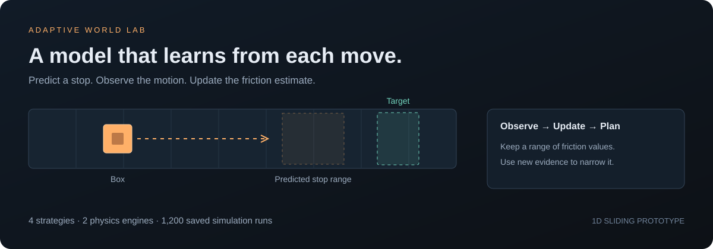

# Adaptive World Lab

**A small physics demo that learns from its mistakes.**

Move a box into a target on an unknown surface. The controller does not know how slippery the surface is. It predicts where the box will stop, watches what happens, and updates its estimate.

The question is simple: **Can a model that learns as it goes do better than a model that keeps the same assumptions?**

This project includes a working browser demo, Python controllers, MuJoCo contact simulation, saved test data, and automated checks. It keeps failed runs and the cost of extra probes.

## Try the demo

You only need Python to serve the browser files. No API key, GPU, or npm install is needed to use the demo.

~~~bash
python -m http.server 8080 --directory dist
~~~

Open [localhost:8080](http://localhost:8080).

1. Press **Start experiment**, or **Step** to inspect one move at a time.
2. Compare **Active adaptation** with **Fixed model** on the same surface.
3. Try **A probe may not pay off** and **The model starts right**. Extra learning can cost more than it saves.
4. Open **Compare strategies** to run a new batch, or load the saved MuJoCo results.

The chart shows possible friction values and how their probabilities change. A narrow range means the model is more certain. It can still be wrong.

## Four ways to solve the same task

| Strategy | What it does |
|---|---|
| Fixed model | Uses the same friction estimate for every move. |
| Passive adaptation | Starts the task and learns from each move. |
| Active adaptation | May choose a small probe to learn before moving toward the target. |
| Robust planning | Plans for the worst case across the full friction range. It does not learn. |

All four strategies face the same cases, position noise, and six-move limit. Probes count as moves.

## What the saved experiments show

The project includes **1,200 MuJoCo runs**: three test sets, 100 cases per set, and four strategies.

Successful runs out of 100:

| Test set | Fixed | Passive | Active | Robust |
|---|---:|---:|---:|---:|
| Unknown fixed friction | 83 | 99 | 100 | 27 |
| Friction changes after the first move | 65 | 90 | 89 | 48 |
| Extra drag that the model does not know about | 88 | 100 | 99 | 24 |

In the fixed-friction set, Active used **3.42 moves** on average. Passive used **2.98**. Active succeeded once more, but needed **0.44 more moves** on average.

**Learning helped in these tests. A separate probe was not always worth its cost.** These results do not establish a statistically significant difference between Active and Passive.

See [the full results](docs/results.md) for costs, uncertainty ranges, and limits. The raw JSON and paired CSV files are in [results](results).

## Run the Python version

Use Python 3.10 or later. These commands are for macOS or Linux.

~~~bash
python -m venv .venv
source .venv/bin/activate
pip install -e '.[mujoco,test]'

# Run all four strategies with MuJoCo.
python -m awm.cli demo --engine mujoco --output results/demo.json

# Run 100 shared cases per strategy.
python -m awm.cli benchmark --engine mujoco --n 100 --seed 2026 \
  --output results/benchmark.json

# Run the checks.
pytest -q
~~~

On Windows, activate the environment with .venv\Scripts\activate.

To use only the numerical simulator, install with pip install -e '.[test]' and omit --engine mujoco. MuJoCo runs here do not use an OpenGL renderer.

To rebuild all three saved MuJoCo test sets:

~~~bash
pip install -r requirements-repro.txt
python -m scripts.reproduce
~~~

The pinned packages record the experiment environment. Results may differ slightly across platforms.

## Run the browser checks

Use Node.js 18 or later.

~~~bash
npm ci
npm test
node scripts/benchmark.mjs 100 2026 uniform
~~~

The browser app has no runtime packages. The jsdom package is only used for interface tests.

## Validation

- 43 Python tests passed, including nine MuJoCo contact cases.
- 13 JavaScript tests passed, including playback, reset, background comparison, and cancellation.
- All 1,200 MuJoCo runs were repeated for this English release. The success counts match the table above.
- Python and JavaScript decisions are checked against each other.
- The source and downloadable archive are checked for common private data.

Browser layout has not been visually checked because the preview service was unavailable. Interface tests check behavior, not visual layout. See [validation details](docs/verification.md).

## How it works

1. **Observe:** read a noisy position measurement.
2. **Predict:** estimate where each candidate release speed would stop the box.
3. **Choose:** take a task move, or a probe if its expected information is worth the cost.
4. **Update:** compare the measured motion with the predictions, then revise the friction belief.
5. **Repeat:** plan again until the box reaches the target or the move limit is reached.

The simulator holds the true friction value. The controller receives only an allowlisted configuration and sensor observations. It cannot read the hidden friction through that interface.

## Project map

| Path | Purpose |
|---|---|
| [awm/core.py](awm/core.py) | Friction belief, model update, and action planning. |
| [awm/plants.py](awm/plants.py) | Independent numerical and MuJoCo worlds. |
| [awm/experiment.py](awm/experiment.py) | Shared cases and fair strategy comparisons. |
| [awm/cli.py](awm/cli.py) | Demo and benchmark commands; JSON and CSV export. |
| [dist](dist) | Browser app, plots, replay controls, and background benchmarks. |
| [tests](tests) | Physics, data boundaries, repeatability, Python/JavaScript agreement, and interface checks. |
| [docs/method.md](docs/method.md) | Model assumptions and algorithm details. |

The project combines simulation, probability, control, data export, and tests. It uses a small physics model rather than a large trained model.

## Limits

- The task is one-dimensional sliding. Release speed is treated as known and exact.
- There is no robot arm, camera tracking, or real-world validation.
- The planner looks ahead one complete glide at a time. It is not a multi-step optimal controller.
- Robust is a simple worst-case baseline, not the best possible robust controller.
- A model-based safety check is not a real-world safety guarantee.
- The data boundary is a software interface, not a sandbox against malicious code.

This is a **simulation-to-simulation research prototype**. It does not prove transfer to a physical robot.

## Next steps

- Compare a separate probe with information already gained during the task.
- Add uncertain release speed and changing friction.
- Test the same interface with real sliding measurements.
- Extend the task to two dimensions and actual pushing contact.

See [privacy notes](docs/privacy.md) for what is excluded from this source release.
